GROUP MEMBERS: Bao Nguyen, Jaeryn Franco

1	Open the app.	Every student from your data file shows, and the three numbers match your data.
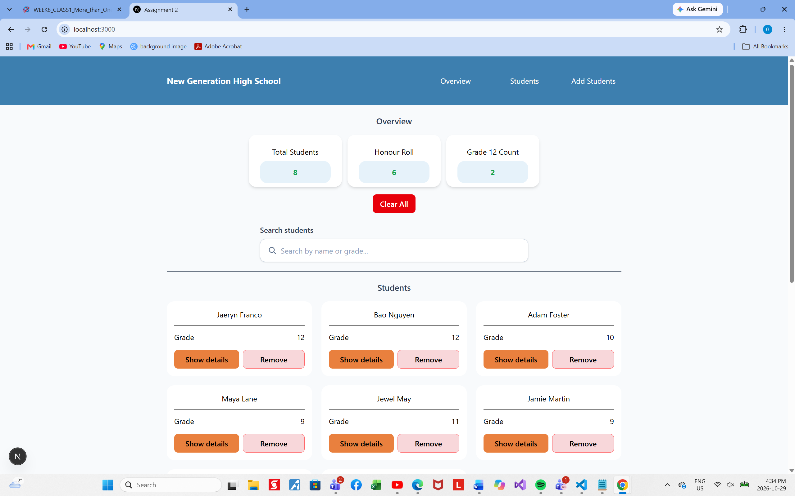 PASS

2	Click Show details on one card, then click it again.	That card shows the average (and Honour roll if it is above 80) and the button reads Hide details. No other card opens. The second click closes it.
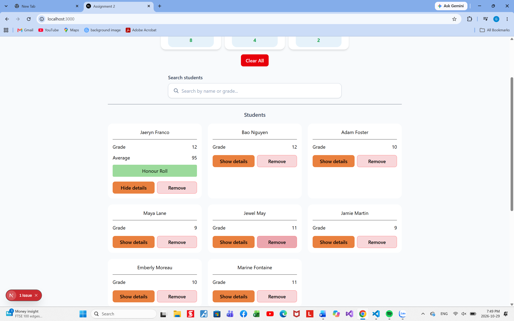 PASS

3	Remove a grade 12 student.	The student is gone, and both Students and Graduating drop by one.
 PASS

4	Type a last name in capitals, such as AHMED, into the search box. Then empty the box.	Only the matching student shows. When the box is empty, every student is back.
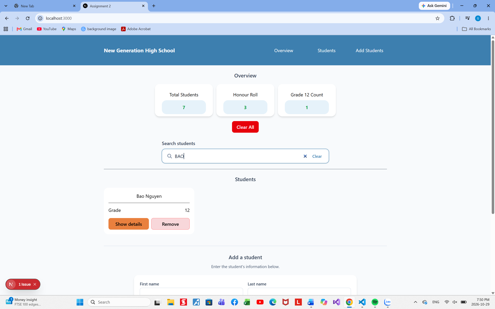 PASS
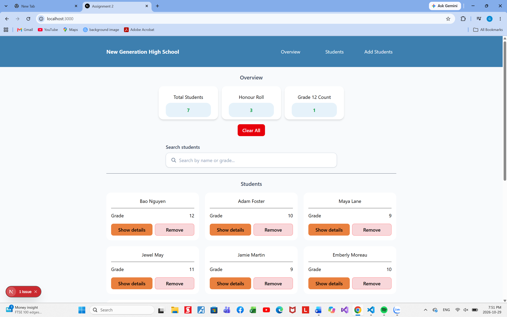 PASS

5	Search for zzz.	The no-students message shows. The three numbers do not change: search changes what is shown, not the list.
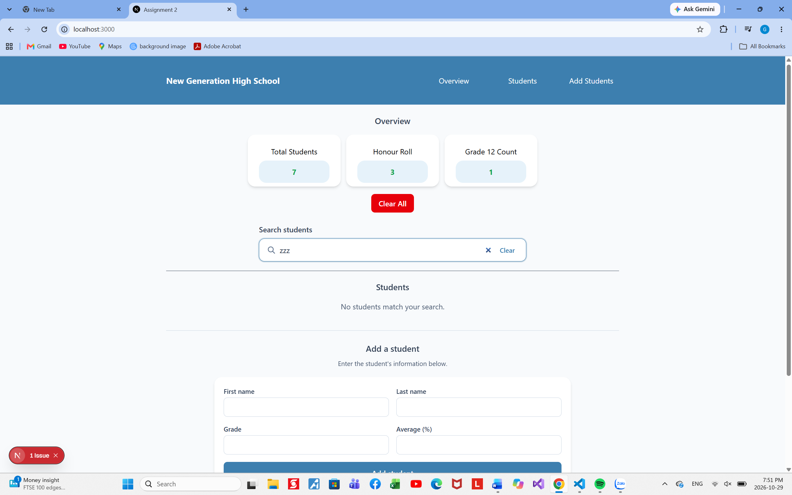 PASS

6	Leave the first name empty, fill in the last name, and click Add student.	Nothing is added.
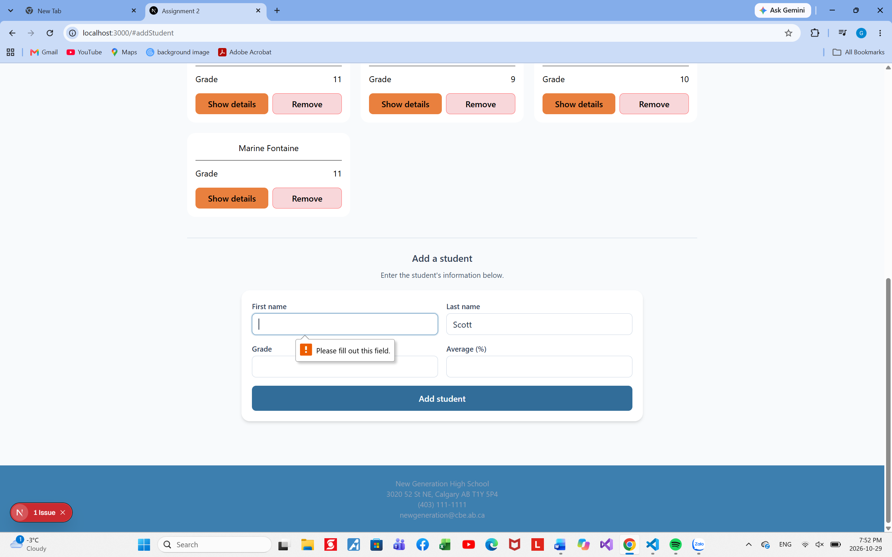 PASS

7	Fill in all four inputs and click Add student.	The student appears, the numbers update, both name inputs are empty, grade shows 9 and average shows 70.
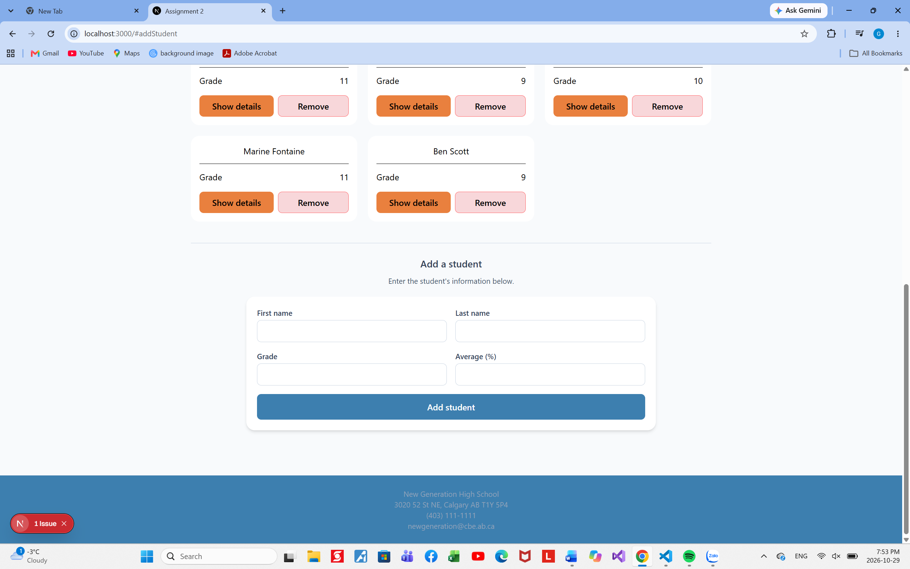 PASS

8	Click Clear all.	The no-students message shows, and all three numbers are 0.
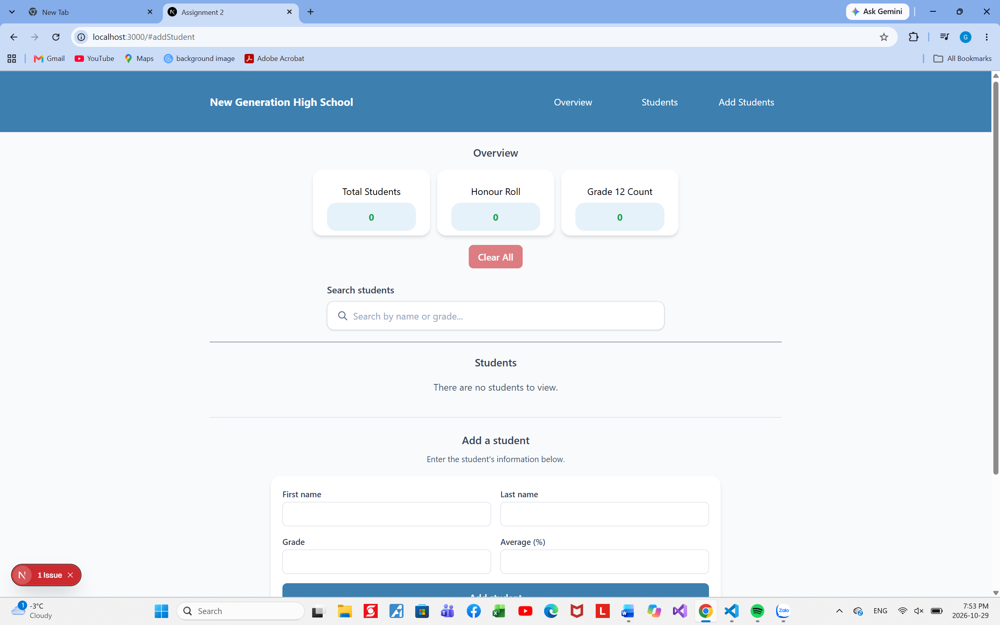 PASS

9	Narrow the browser to phone width (DevTools device toolbar).	The cards stack in one column, and nothing scrolls sideways.
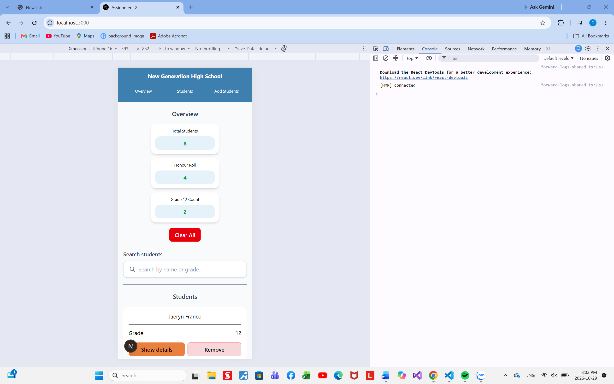 PASS

10	Click each link in the navbar.	The page jumps to that section.
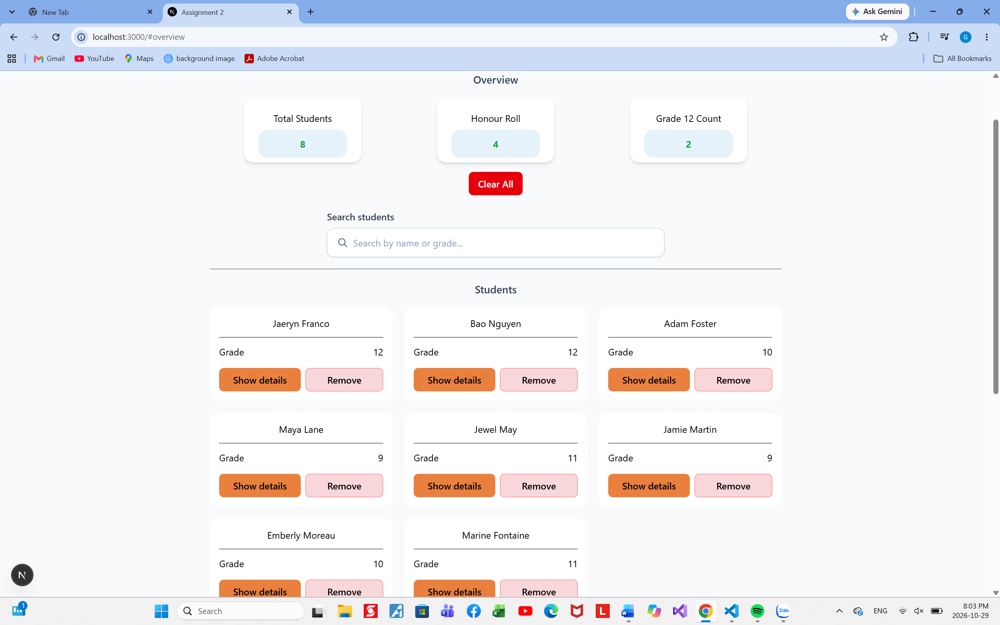 PASS
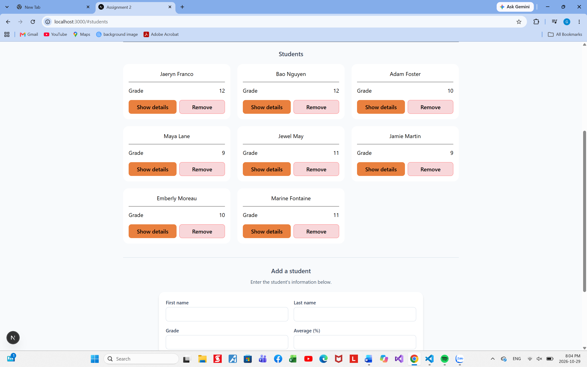 PASS
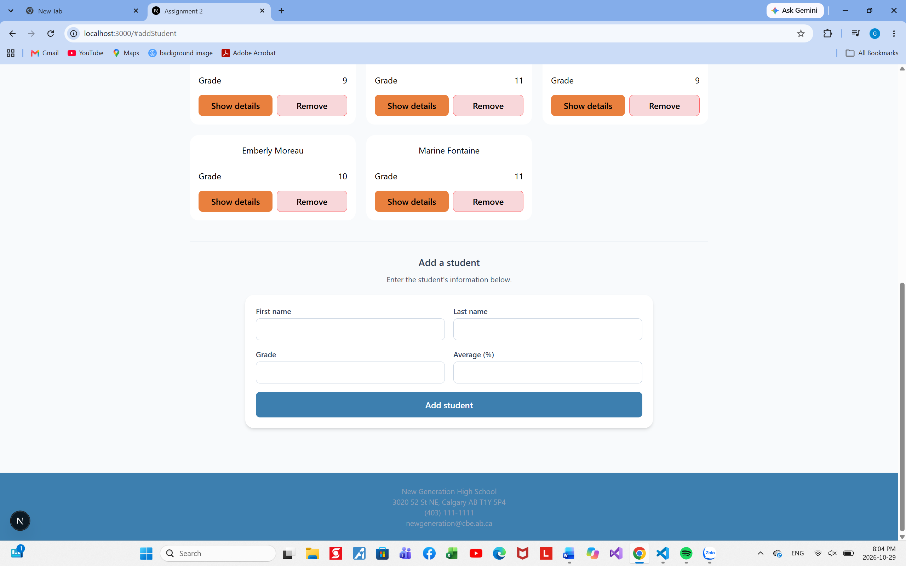 PASS
